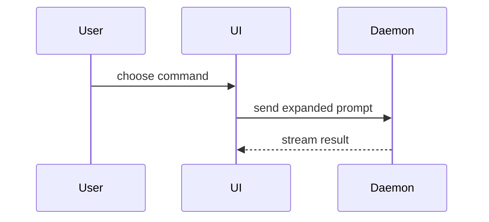

# pr

A PR body by `template.md`, in two layers:

- The **part in view** is what a reviewer acts on before the merge. Keep it
  under about 2,500 bytes.
- The **record** is the rest: rejected options, new concepts, the evidence
  output, other findings. It goes to the **debrief** of the work, the page
  that the `debrief` skill made, when that page can be published. When it
  cannot, the record goes into a closed `<details>` at the end of the body.

The two layers never repeat each other. The one exception is Evidence: the
part in view has one line per check, and the record has the output.

## Steps

1. **Find the debrief.** Look in the Lavish folder of the current directory,
   `~/.local/share/lavish-axi/<dir-hash>/`, where `<dir-hash>` is
   `printf '%s' "$PWD" | shasum -a 256 | cut -c1-12`. The debrief is the page
   whose header starts with "Debrief" and that describes the work of this PR.
   When more than one page matches, use the newest. Done when you have the
   page, or you know there is none.
2. **Collect.** With a debrief, take its asked items and their status, the
   differences, the evidence, the rollback, what is not done and its merge
   assessment. With none, do steps 1 and 2 of the `debrief` skill, and do not
   write the page. Done when each part of `template.md` has its source, or
   nothing applies to it.
3. **Publish it.** With a debrief, from the repository, run
   `scripts/share-debrief <page>` from this skill's directory. It picks the
   host from the owner and visibility of the repository, publishes the page,
   and prints one Markdown line. Exit status 3 means a private personal
   repository, which has no host. Done when you have the line, or you know
   the page cannot be shared: no page, exit 3, or an error.
4. **Write the body.** Write it by `template.md` to a new temporary file, and
   print its path. With the line, put it first and leave out the record.
   Without it, put the record in the closed `<details>`. Write the
   [axes](#axes), the [decisions](#decisions), the [views](#views) and the
   [evidence](#evidence) by the rules below, in the user's domain language
   from `GLOSSARY.md` or `CONTEXT.md`. When the part in view grows past
   about 2,500 bytes, move detail into the record. Run the text through
   `pstack:unslop`. Done when the body has each heading of `template.md`,
   word for word, and `None.` where nothing applies.

## Axes

The axes line and the **Merge:** line show the merge assessment of the
change, by the `debrief` skill's Merge assessment rules
(`../debrief/SKILL.md`): 🚪 door, 💥 blast radius, 🔒 security,
🔬 verification, ⚠️ high-risk item, ↩️ reversible, and the verdict. Copy
the verdict word for word.

Colour each value with GitHub math: green for the safe value, red for a value
that raises the risk, and red for the ⚠️ part:

```
🚪 $\color{green}\textsf{two-way}$ · 💥 $\color{red}\textsf{large}$ · 🔒 $\color{green}\textsf{none}$ · 🔬 $\color{green}\textsf{verified}$
```

When a revert undoes all of the change, end the axes line with a green
`↩️ reversible`:

```
🚪 $\color{green}\textsf{two-way}$ · 💥 $\color{green}\textsf{layout}$ · 🔒 $\color{green}\textsf{none}$ · 🔬 $\color{green}\textsf{verified}$ · ↩️ $\color{green}\textsf{reversible}$
```

Otherwise, put a ↩️ line under the axes line. It says how to undo the change,
and what does not come back after it. List the verdict's other reasons in
"What is left".

## Decisions

List each decision that changes the current state: a new approach, a change
to an existing one, a move away from the existing design. Leave out
boilerplate that follows a pattern the code already uses many times. Mark
each by who made it:

- **you:** the human made or approved it, in the planning page, in chat, or
  in an answer to a question.
- **agent:** no human made or approved it. These are the asked items done
  differently and what no item asked. Give each its reason.

## Views

Pick the smallest view that makes the key point clear for "What changed".
Place each view next to the short text it supports. Keep only the calls,
files, props, states and boundaries the reviewer needs. One view is usual;
use two when the change has two points.

- Show logic or an algorithm as pseudocode:

```text
on(save)
  if content is unchanged
    return cached result
  write new content
  return fresh result
```

- Show runtime control flow as a call tree:

```text
submitForm
  createSession
    persistPrompt
    launchAgent
  navigateToSession
```

- Show UI structure as a component tree, including state and module
  boundaries that matter:

```text
<SessionPage> (apps/example/src/routes/session.tsx)
  useSessionEvents()
  <SessionToolbar>
    <RunSkillButton> (packages/ui)
```

- Show file responsibility or a broad refactor as a shallow file tree:

```text
src/
├── commands/       # parses user actions
├── sessions/       # owns session state
└── transport/      # sends API requests
```

- Show component interaction, control flow or data flow with Mermaid:



- Use `diff` when the point is what changes and the surrounding shape already
  exists. Match the diff shape to the topic: a component tree, a file tree, a
  call tree, or a state or control flow:

```diff
 on(save)
-  write content
+  if content is unchanged
+    return cached result
+  write new content
+  invalidate cache
```

- Show the whole block when most of it is new, when omitted context would
  hide ownership or order, or when the reviewer needs a copyable target shape.

When an axis is red, show the change as before and after.

## Evidence

Show concrete evidence that the change works, before and after. A screenshot
is S-tier, when the environment is set up for it and the change is visual.
Execution is A-tier: test results and console output. Name the exact test
that failed before and passes now. Say what did not run.
